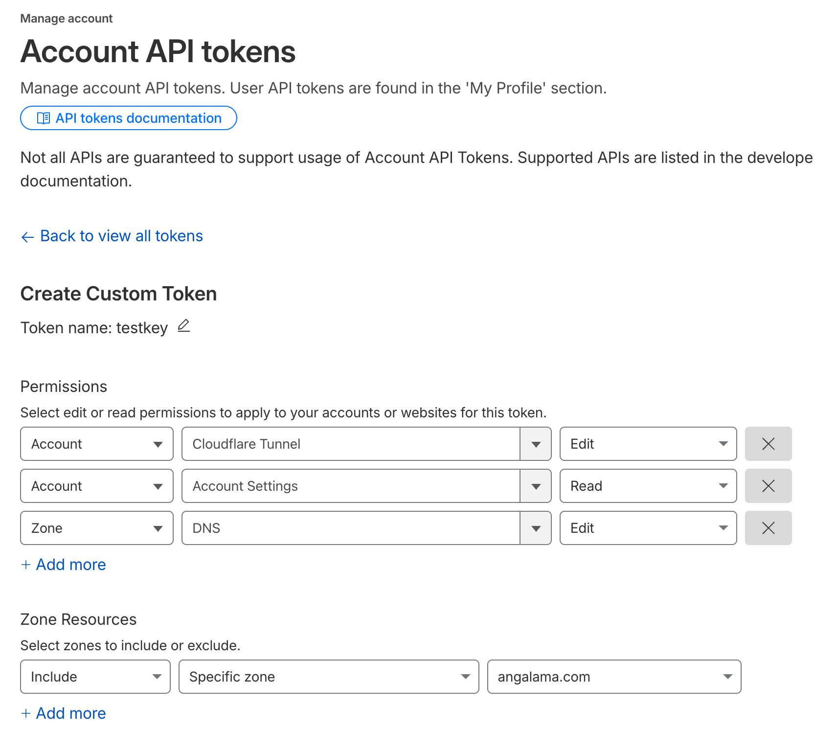

# cfeasy


<!-- WARNING: THIS FILE WAS AUTOGENERATED! DO NOT EDIT! -->

cfeasy is for people who host their own services on a server and use
Cloudflare for the domain. It does two jobs. It writes DNS records, the
entries that say where a name like `app.example.com` points. And it sets
up Cloudflare Tunnels, which let visitors reach a service on your server
without opening any ports on it.

Cloudflare publishes an official [Python
SDK](https://github.com/cloudflare/cloudflare-python) that can do all of
this, but each job takes several calls and you have to look up zone and
account IDs yourself. cfeasy wraps the SDK in one class,
[`CF`](https://vedicreader.github.io/cfeasy/core.html#cf), whose methods
take domain and tunnel names and find the IDs for you. The examples on
this page ran against a real Cloudflare account; they are marked so that
the docs build does not run them again.

## Install

``` sh
pip install cfeasy
```

## Create an API token

cfeasy talks to Cloudflare with an API token. It needs a custom token,
which you create with only the permissions you choose. The older Global
API Key, which can do anything on the account, does not work with it.

Open
[dash.cloudflare.com/profile/api-tokens](https://dash.cloudflare.com/profile/api-tokens),
choose Create Token, then Custom Token, and add these three permissions:

<table>
<colgroup>
<col style="width: 33%" />
<col style="width: 33%" />
<col style="width: 33%" />
</colgroup>
<thead>
<tr>
<th>What it is for</th>
<th>Resource</th>
<th>Permission</th>
</tr>
</thead>
<tbody>
<tr>
<td>Reading and writing DNS records</td>
<td>Zone -&gt; DNS</td>
<td>Edit (limit it to your zone)</td>
</tr>
<tr>
<td>Finding your account ID</td>
<td>Account -&gt; Account Settings</td>
<td>Read</td>
</tr>
<tr>
<td>Creating and deleting tunnels</td>
<td>Account -&gt; Cloudflare Tunnel</td>
<td>Edit</td>
</tr>
</tbody>
</table>

<figure>

<figcaption aria-hidden="true">Cloudflare custom token
setup</figcaption>
</figure>

## Connect and check the token

[`CF`](https://vedicreader.github.io/cfeasy/core.html#cf) takes the
token as its first argument. If you leave it out, the SDK reads it from
the `CLOUDFLARE_API_TOKEN` environment variable, which keeps the token
out of your code.

Set `CLOUDFLARE_API_TOKEN` before you call
[`CF()`](https://vedicreader.github.io/cfeasy/core.html#cf). To pass the
token directly, use `CF('your-token')`. Before changing anything, call
`verify`. It only reads: it looks up your account, lists your zones (a
zone is a domain you manage on Cloudflare) and lists your tunnels. It
also checks that the token is active. It returns `ok`, the token status,
the account ID, the zone names and the tunnel count. If a check fails,
usually because the token is expired or lacks one of the permissions
above, `ok` is False and `errors` holds Cloudflare’s message for each
failed check. Pass `domain` to check one zone instead of listing them
all.

``` python
from cfeasy import *
```

``` python
c = CF()
c.verify()  # -> {'ok': True, 'token': 'active', ...}
```

    {'ok': True,
     'token': 'active',
     'account': '…',
     'zones': ['angalama.com'],
     'tunnels': 1,
     'errors': {}}

## DNS records

A DNS record tells the internet where a name such as `app.angalama.com`
points. An A record holds an IPv4 address, and a CNAME record holds
another name to look up instead.

`upsert_record` is the method to use for writing a record, because
running it a second time leaves you with the same result instead of a
duplicate. You give it the domain, the name, and the content. The name
`@` means the domain itself. A name that equals the domain, or ends with
a dot and the domain, is used as written. Any other name, such as `app`
or `api.internal`, is a subdomain of the domain. The record type
defaults to A.

The method looks at the records of the requested type under that name.
Records of other types stay untouched. If none exists, it creates the
record. Otherwise it keeps one record: the first with the requested
content, else the first of that type. It updates the kept record in
place when its content or `proxied` setting differs. It deletes the
other records of that type under the name. The example below points
`app.angalama.com` at the address 1.2.3.4 and returns the record as
Cloudflare stored it:

``` python
dom, nm = 'angalama.com', 'app'
c.upsert_record(dom, nm, "1.2.3.4")
```

    {'name': 'app.angalama.com',
     'type': 'A',
     'comment': None,
     'content': '1.2.3.4',
     'proxied': False,
     'settings': {'ipv4_only': None, 'ipv6_only': None},
     'tags': [],
     'ttl': 1,
     'id': '3819309b81252192134793a601f43737',
     'created_on': datetime.datetime(2026, 3, 22, 20, 3, 29, 872980, tzinfo=TzInfo(0)),
     'meta': {},
     'modified_on': datetime.datetime(2026, 3, 22, 20, 3, 29, 872980, tzinfo=TzInfo(0)),
     'proxiable': True,
     'comment_modified_on': None,
     'tags_modified_on': None}

## Tunnels

A [Cloudflare
Tunnel](https://developers.cloudflare.com/cloudflare-one/connections/connect-networks/)
solves the problem of exposing a service on a server that you would
rather not open to the internet. A small program called `cloudflared`
runs next to your service and makes an outgoing connection to
Cloudflare. When someone visits `app.example.com`, Cloudflare sends the
request down that connection, and `cloudflared` passes it to your
service. The server needs no open ports and no public IP address.

Three things have to exist for this to work:

1.  A tunnel, registered with your Cloudflare account under a name you
    choose.
2.  A CNAME record that points your subdomain at
    `<tunnel-id>.cfargotunnel.com`, the address Cloudflare gives every
    tunnel.
3.  A tunnel token, a secret string you give to `cloudflared` so that it
    connects to the right tunnel.

The cell below makes each one by hand. `tunnels` lists the account’s
tunnels, so the code reuses a tunnel called `my-app` if there is one and
calls `create_tunnel` if not. `tunnel_cname` writes the CNAME record
through `upsert_record`, with Cloudflare’s proxy turned on, which a
tunnel needs. `tunnel_token` fetches the token.

``` python
tname = 'my-app'
exists = L.filter(lambda x: x.get('name') == tname)
tid = first(t)['id'] if (t:=exists(c.tunnels())) else c.create_tunnel(tname)['id']
c.tunnel_cname(dom, nm, tid)
token = c.tunnel_token(tid)
```

## Set up a tunnel in one call

`setup_tunnel` does the three steps above for you, and it is the method
to reach for unless you need to control each step. It returns the tunnel
ID and the token. Pass the token to `cloudflared`, for example as the
`CF_TUNNEL_TOKEN` environment variable that the `cloudflared_svc`
service in the dockeasy package reads.

Give it a domain and a subdomain name to serve `app.example.com`, as in
the first example. Leave the name out to serve the domain itself, as in
the second. A CNAME record at the root of a domain is normally not
allowed, but Cloudflare accepts it and resolves it to addresses on its
side, which it calls CNAME flattening.

The tunnel is named after the subdomain, or after the domain when there
is no subdomain; pass `tunnel_name` to choose another name. If a tunnel
with that name already exists it is reused, so calling `setup_tunnel`
again does not make a second one.

``` python
tid, token = c.setup_tunnel(dom, nm)
tid, token
```

``` python
tid_apex, token_apex = c.setup_tunnel(dom)
tid_apex, token_apex
```

`tunnel_id` finds a tunnel’s ID from its name, which helps when you set
a tunnel up earlier and kept only the name. `setup_tunnel` names a
tunnel after its subdomain, or after the domain for an apex tunnel, so
those are the names to look up. `delete_tunnel` removes a tunnel by ID;
together the two clean up both tunnels made above. Deleting a tunnel
leaves its CNAME record in place, so remove that with `delete_record` if
you no longer need it.

``` python
c.tunnel_id(nm)          # -> UUID of the `app` tunnel
c.tunnel_id(dom)         # -> UUID of the apex tunnel
```

``` python
c.delete_tunnel(c.tunnel_id(nm))
c.delete_tunnel(c.tunnel_id(dom))
```

## Cache rules and purges

`ruleset_upsert` writes cache rules or custom firewall rules into a
zone. It replaces your rules by their `ref`, keeps everyone else’s
whole, and returns False when the zone already has them. A deploy can
run it every time. `purge` empties the cache by URL, by URL prefix or
entirely. It retries rate limits, connection errors, HTTP 408, HTTP 409
and HTTP 5xx responses. It waits before each retry, and each wait is
twice the previous wait. By default, `purge` raises a refusal caused by
a plan or permission restriction. Set `fallback_all=True` to request a
full purge after the refusal instead, and `purge` reports that in its
return value. Any other error raises. Both need a token with the
matching zone permissions: Cache Rules -\> Edit, Zone WAF -\> Edit for
firewall rules, and Cache Purge -\> Purge.

``` python
zid = c.zone_id(dom)
rule = dict(ref='static', expression='starts_with(http.request.uri.path, "/static/")', action='set_cache_settings',
            action_parameters=dict(cache=True), enabled=True)
c.ruleset_upsert(zid, [rule])                # True the first time, False after
c.purge(zid, prefixes=[f'{dom}/static/'])                      # [{'prefixes': [...]}], raises if refused
c.purge(zid, prefixes=[f'{dom}/static/'], fallback_all=True)   # [{'purge_everything': True}] if refused
```
